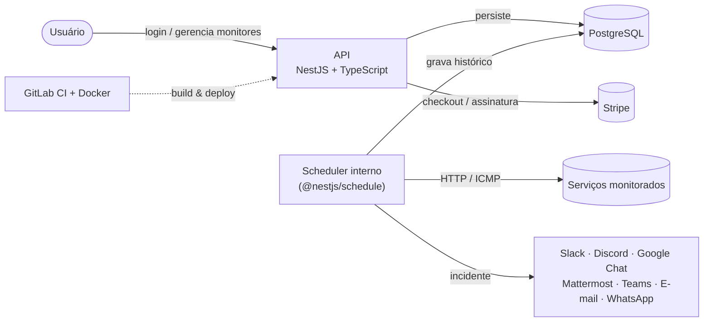

<p align="center">
  
</p>

<h1 align="center">Systatus</h1>

<p align="center">
  <strong>Descubra falhas antes dos seus clientes.</strong>
</p>

<p align="center">
  API de monitoramento de disponibilidade do Systatus, com verificações periódicas de serviços,<br/>
  gestão de incidentes, envio de alertas e gerenciamento de assinaturas.
</p>

<p align="center">
  <a href="LICENSE"></a>
  
  
</p>

---

> [!IMPORTANT]
> O produto **[systatus.live](https://systatus.live)** foi descontinuado. O código-fonte está disponível sob a licença Apache 2.0 para estudo, adaptação e desenvolvimento de novos projetos pela comunidade.

Este repositório contém a **API do Systatus**. A interface para gerenciar monitores e visualizar métricas está disponível no repositório do painel web: [systatus-live/systatus-live-frontend](https://github.com/systatus-live/systatus-live-frontend).

## Demonstração

Interface do painel web integrado à API, disponível em [systatus-live/systatus-live-frontend](https://github.com/systatus-live/systatus-live-frontend):

<p align="center">
  
</p>

## Funcionalidades

- Monitoramento HTTP (DNS, TCP, TLS e TTFB via `curl`) e ICMP via `ping`, com intervalo de 1 minuto a 24 horas conforme o plano.
- Abertura e encerramento automáticos de incidentes, com até 30 dias de histórico de uptime por monitor.
- Alertas em 7 canais: Slack (Webhook), Discord (Webhook), Google Chat (Webhook), Mattermost (Webhook), Microsoft Teams (Webhook), e-mail (Resend) e WhatsApp (Meta Business API).
- Modelos de notificação personalizáveis por integração, conforme as permissões do plano.
- Página pública de status identificada por slug, com acesso independente do painel.
- Checkout, assinaturas e faturas via Stripe, com geração de PDF sob demanda.
- Autenticação por e-mail com verificação por código (OTP) ou Google OAuth, com validação do status da assinatura pelo guard de autenticação.
- Registro de requisições com criptografia AES-256 do corpo antes do armazenamento.

## Tecnologias e arquitetura



| Camada | Tecnologia | Papel no projeto |
| --- | --- | --- |
| API | NestJS 11 · TypeScript · Node 24 | Framework HTTP, guards de autenticação e assinatura, versionamento de rotas |
| Banco | PostgreSQL · TypeORM 0.3 | Persistência e migrations |
| Autenticação | `@nestjs/jwt` · bcrypt · Google OAuth | Sessão, hash de senha, login social |
| Pagamentos | Stripe | Checkout, assinaturas, webhooks, faturas |
| Notificações | axios (webhooks) · Resend (e-mail) · WhatsApp Business API | Envio de alertas por múltiplos canais |
| Monitoramento | `curl` (HTTP) · `ping` (ICMP) | Verificações agendadas via cron interno |
| PDF | pdfmake | Geração de fatura em PDF |
| Armazenamento | Vercel Blob | Avatares de usuário |
| Infraestrutura | Docker · GitLab CI | Build e deploy |

## Execução local

Requisitos: Node.js 24 ou superior e uma instância acessível do PostgreSQL.

```bash
git clone https://github.com/systatus-live/systatus-live-backend.git
cd systatus-live-backend
npm ci
cp .env.example .env   # preencha com suas credenciais
npm run dev
```

As migrations são executadas automaticamente na inicialização (`migrationsRun: true`). A API fica disponível em `http://localhost:3000`. Para utilizar outra porta, configure a variável `PORT`.

<details>
<summary>Variáveis de ambiente</summary>

| Variável | Descrição |
| --- | --- |
| `DATABASE_HOST` / `DATABASE_PORT` / `DATABASE_USERNAME` / `DATABASE_PASSWORD` / `DATABASE_NAME` | Conexão com o PostgreSQL |
| `JWT_KEY` / `ENCRYPT_KEY` | Assinatura dos tokens de sessão e criptografia AES de dados sensíveis |
| `GOOGLE_OAUTH_CLIENT_ID` | Client ID do login social com Google |
| `RESEND_API_KEY` / `MAIL_FROM_ADDRESS` / `CONTACT_EMAIL` | Envio de e-mails transacionais e destino do formulário de suporte |
| `STRIPE_SECRET_KEY` / `STRIPE_WEBHOOK_SECRET` / `STRIPE_PRICE_ID_CORUJA` / `STRIPE_PRICE_ID_AGUIA` | Checkout, assinaturas e webhooks de pagamento |
| `WHATSAPP_PHONE_NUMBER_ID` / `WHATSAPP_API_KEY` | Notificações via WhatsApp Business API |
| `VERCEL_BLOB_READ_WRITE_TOKEN` | Armazenamento dos avatares de usuário |
| `WEB_URL` | Origem liberada no CORS e usada em links dos e-mails |

Consulte a lista completa de variáveis, incluindo as configurações de infraestrutura, em [.env.example](.env.example).

</details>

## Docker

```bash
docker compose up -d --build
```

O comando inicia a API na porta `4003`, conforme definido em [docker-compose.yml](docker-compose.yml), utilizando o build multi-stage de [Dockerfile.prod](Dockerfile.prod).

## Licença

Este projeto está licenciado sob a [Apache 2.0](LICENSE).
